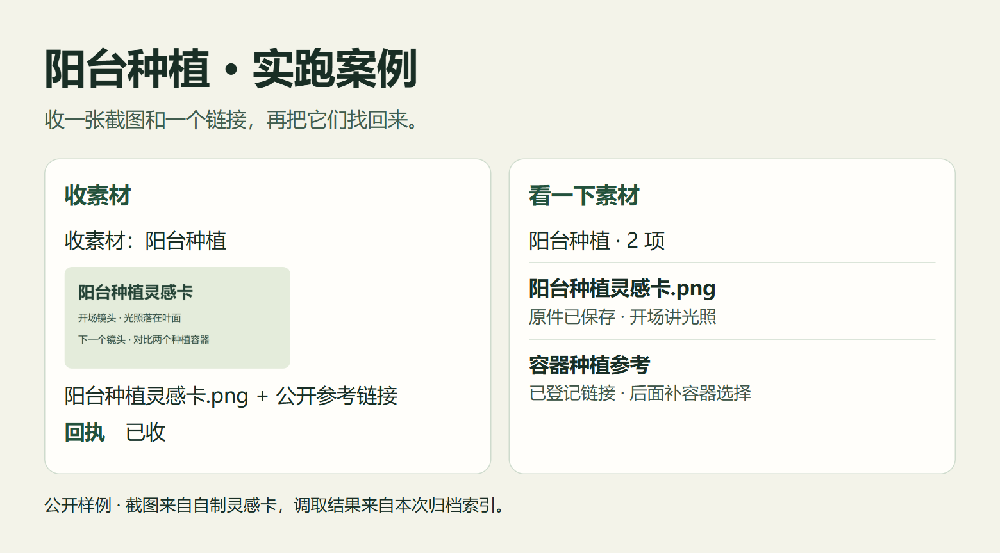

# 视频素材匣

**把截图、文件和链接按主题收好，做视频时随时找回。**

看到一张参考图，顺手发给助手。过几天开始剪视频，说一声「看一下素材」，它就会列出这个主题里收过的内容和备注。

[逐步体验](https://professormin.github.io/video-material-inbox/#demo) · [下载 v0.1.3 ZIP](https://github.com/Professormin/video-material-inbox/releases/download/v0.1.3/video-material-inbox-v0.1.3.zip) · [下载最新版](https://github.com/Professormin/video-material-inbox/releases/latest)

[](https://professormin.github.io/video-material-inbox/#case)

## 复制这句话安装

把这句话发给支持安装 Skill 的助手，例如 Codex：

```text
请帮我安装「视频素材匣」：https://github.com/Professormin/video-material-inbox
```

## 装好后怎么说

| 你想做什么 | 你可以这样说 |
| --- | --- |
| 开始收一个主题 | **收素材：阳台种植** |
| 投递素材 | 直接发截图、文件或链接，也可以顺手加一句备注 |
| 查看收过什么 | **看一下素材** |
| 换个聊天继续找 | **打开阳台种植的素材** |

也可以只说「收素材」。当前聊天已有主题时会继续收进该主题，第一次收时助手会问主题名。可读取的文件会保存副本，网页链接会保留为引用。

案例用的是自制的阳台种植截图和公开参考链接。你可以在演示页逐步查看这一轮收存与调取。

[打开演示页](https://professormin.github.io/video-material-inbox/) · [MIT 许可证](LICENSE)
